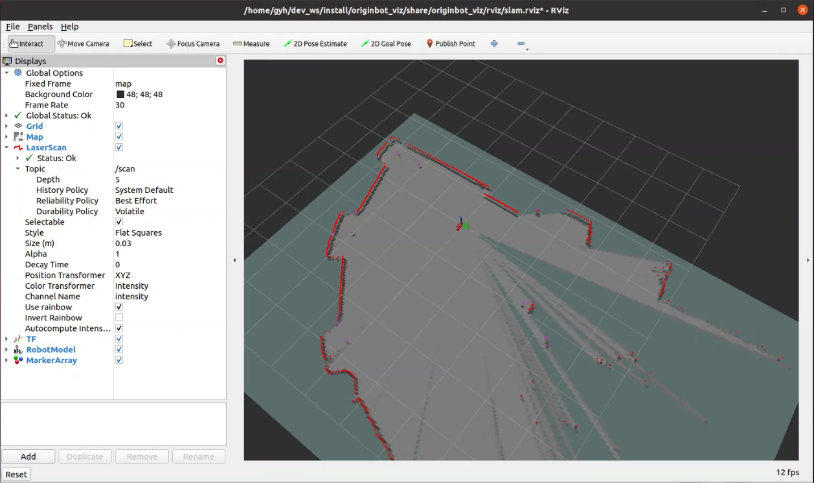
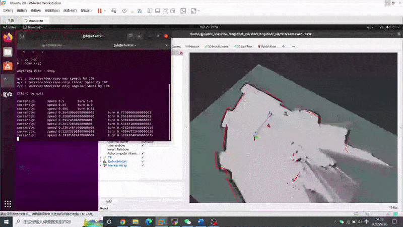
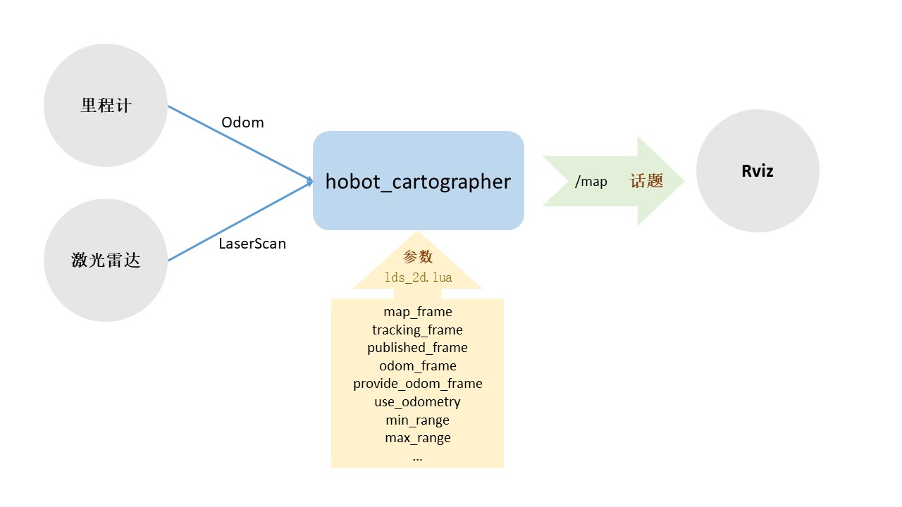

English| [简体中文](./README_cn.md)

# Function Introduction

SLAM stands for Simultaneous Localization And Mapping, which means real-time positioning and map building. In simple terms, when a robot enters an unknown space, it doesn't know where it is and what the surrounding environment looks like. It needs to gradually build a cognitive map of the environment through its sensors and determine its real-time position.

SLAM does not refer to a specific algorithm, but rather a technology. There are many algorithms that can implement this technology. The Cartographer used in this function is a SLAM algorithm based on graph optimization introduced by Google. It can achieve the positioning and mapping functions of robots in two-dimensional or three-dimensional conditions. The main design goal of this algorithm is to enable robots to obtain high-precision maps in real time even when computational resources are limited. This function supports two types of experiences: physical robots and Gazebo simulation.

# Bill of Materials

The following robots are all compatible with RDK X3

| Robot Name          | Manufacturer | Reference Link                                               |
| :------------------ | ------------ | ------------------------------------------------------------ |
| OriginBot Smart Robot | Guyueju      | [Click to jump](https://www.originbot.org/)                  |
| X3 Pai Robot         | Lunqu        | [Click to jump](https://item.taobao.com/item.htm?spm=a230r.1.14.17.55e556912LPGGx&id=676436236906&ns=1&abbucket=12#detail) |
| Tracked Smart Car    | Weixue Electronics | [Click to jump](https://detail.tmall.com/item.htm?abbucket=9&id=696078152772&rn=4d81bea40d392509d4a5153fb2c65a35&spm=a1z10.5-b-s.w4011-22714387486.159.12d33742lJtqRk) |
| RDK X3 Robot        | Multiple Manufacturers | [Click to jump](https://developer.horizon.ai/sunrise) |

# Instructions for Use

## Preparation

1. The robot should have a motion chassis, camera, and RDK kit, with hardware connected and tested;
2. ROS low-level driver is installed, and the robot can receive "/cmd_vel" commands to move correctly;
3. Lidar driver is installed and able to publish the /scan topic;
4. PC computer has completed the installation of Ubuntu, ROS Foxy/Humble.

## Install hobot-cartographer package

After starting the robot, connect to the robot through the terminal or VNC, click the "One-click Deployment" button in [NodeHub hobot-cartographer](http://it-dev.horizon.ai/nodehubDetail/170117036053371409) in the upper right corner, copy and run the following commands on the RDK system to install the hobot-cartographer package.

```bash
sudo apt update
sudo apt install -y tros-hobot-cartographer
```

## Run cartographer

Taking OriginBot as an example here, the commands for different types of robots in the first three steps may vary.

**1. Start the robot chassis**

Start the robot and connect to it through the terminal or VNC. The startup command for OriginBot is as follows:

```bash
# Set up the tros environment variables
source /opt/tros/setup.bash

# Set up the ROS environment variables
source /opt/ros/foxy/setup.bash
# Launch OriginBot
ros2 launch originbot_base robot.launch.py 
```

**2. Start the Lidar**

To start the lidar, connect to the robot through the terminal or VNC, and use the following command:

```bash
# Set the environment variables for tros
source /opt/tros/setup.bash

# Set the environment variables for ros
source /opt/ros/foxy/setup.bash

# Launch the lidar
ros2 launch ydlidar_ros2_driver ydlidar_launch.py
```

**3. Start Cartographer**

To start cartographer, connect to the robot through the terminal or VNC, and use the following command:

```bash
# Set the environment variables for tros
source /opt/tros/setup.bash

# Set the environment variables for ros
source /opt/ros/foxy/setup.bash

# Launch cartographer
ros2 launch hobot_cartographer cartographer.launch.py
```

**4. View SLAM Dynamic Effects**

To facilitate viewing the complete process of SLAM, on a PC in the same network, launch the Rviz visualization software:

```bash
ros2 run rviz2 rviz2
```

Once successfully launched, add Map, LaserScan, TF, RobotModel, and other display items to see the current map effect.



**5. Remotely Control the Robot to Build Maps**

To enable the robot to obtain complete information about the surrounding environment, we also need to launch a keyboard control node:
```bash
# Set environment variables for TROS
source /opt/tros/setup.bash

# Set environment variables for ROS
source /opt/ros/foxy/setup.bash

ros2 run teleop_twist_keyboard teleop_twist_keyboard
```

Now, we can control the robot to explore unknown environments by pressing the arrow keys on the keyboard in the teleoperation terminal. The map will gradually appear in Rviz.

**6. Save the map**

After mapping is complete, you can use the following command to save the map in the current path:

```bash
# Install tros-hobot-nav2
sudo apt install -y tros-hobot-nav2

# Set environment variables for TROS
source /opt/tros/setup.bash

# Set environment variables for ROS
source /opt/ros/foxy/setup.bash

ros2 run nav2_map_server map_saver_cli -f my_map --ros-args -p save_map_timeout:=10000
```



# Interface Description



## Topics

### Subscribed Topics

| Name  | Message Type             | Description |
| ----- | ------------------------ | ----------- |
| /imu  | sensor_msgs/msg/Imu      | Inertial Measurement Unit (IMU) data |
| /odom | nav_msgs/msg/Odometry    | Odometry information |
| /scan | sensor_msgs/msg/LaserScan| Laser scan data |

### Published Topics

| Name  | Message Type             | Description |
```| /submap_list | cartographer_ros_msgs/msg/SubmapList | Submap list |
| /map | nav_msgs/msg/OccupancyGrid | Map data |

## Parameters

For the meaning and adjustment of parameters, please refer to the [Cartographer parameter tuning guide](https://google-cartographer-ros.readthedocs.io/en/latest/algo_walkthrough.html)

# References

- Cartographer Official Documentation: [Click here to jump](https://google-cartographer.readthedocs.io/en/latest/)

# Frequently Asked Questions

None currently.
